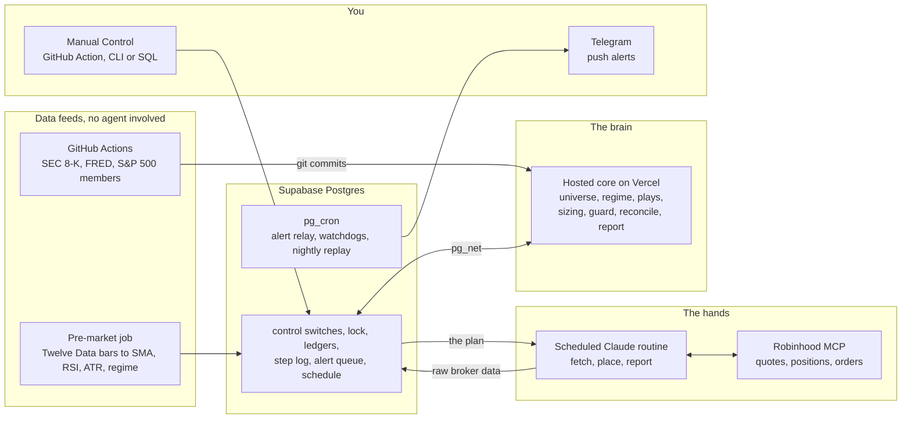
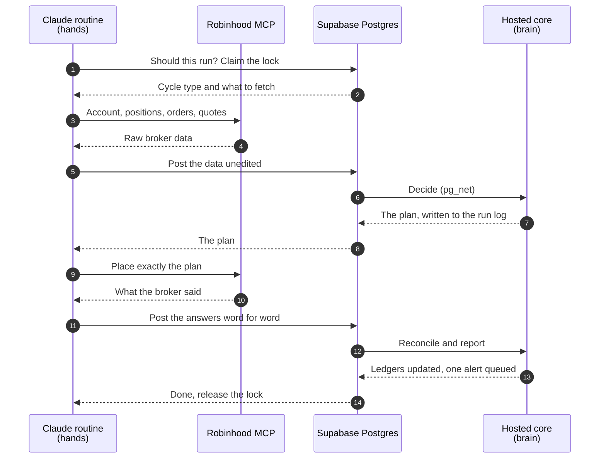
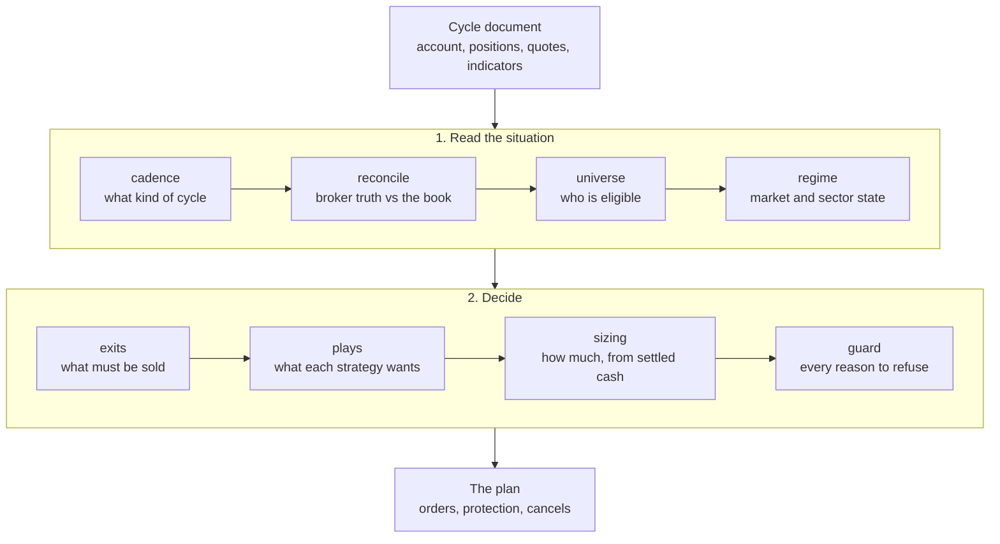

# deterministic-trader

**An AI agent that trades a real brokerage account, and is never allowed to make a trading decision.**

[](https://github.com/jkspeaks/deterministic-trader/actions/workflows/tests.yml)


[](https://m8ven.ai/mcp/jkspeaks-deterministic-trader-h3y34a?s=readme)

A complete, unattended swing-trading system for one cash brokerage account. A deterministic Python core holds every rule: what to buy, how much, when to sell, and every reason to refuse. A scheduled Claude session is only the hands. It fetches broker data, hands it to the core, and places exactly the orders the plan names, at the prices the plan gives.

The result is an agent you can audit. Every decision is a pure function of stored inputs, so it can be replayed offline, tested, and measured against a rule change before that change touches money.

Fork it, point it at your own account, and make it yours: the strategies, the risk limits, the sectors and the schedule are all yours to change.

> **Not financial advice.** This is a reference implementation of a personal trading system. It is not a product and not a recommendation to trade any security. It is built for one small brokerage account, carries no warranty of any kind (see [LICENSE](LICENSE)), and can lose money, including all of it. Use, fork, or adapt it entirely at your own risk.

---

## Why fork this

- **The whole system, not a demo.** Strategies, sizing, risk guard, broker reconciliation, a database schema, scheduled jobs, alerting, operator controls, a backtest engine and the prompts the agent runs. Nothing is left as an exercise.
- **The model cannot improvise a trade.** It places only what `plan.orders`, `plan.protection` and `plan.cancels` name. The plan is written to the run log before anything is placed.
- **Decisions are reproducible.** The core has no network access, and a test proves it. Stored cycle inputs are replayed nightly against rule variants, so a rule change is measured before it trades.
- **It fails closed.** Missing data, an ambiguous broker answer, a stale universe or an implausible account read each stop new entries. Exits are still placed.
- **It checks its own book.** Every reconciling cycle compares the broker's positions and orders with what the system intended and classifies each disagreement. It never silently repairs one.
- **It reports on itself.** One status push per cycle from a fixed list of 42 alert titles, each with a written meaning and action. A watchdog in the database alerts if the queue or a cycle stalls.
- **It is honest about what works.** Each strategy was tested offline against random controls, and the README says which ones failed. See [How strategies are judged](#how-strategies-are-judged).
- **It is built to be changed.** More than 80 documented settings, strategy switches that record what they would have done while off, and 3,400+ tests that tell you what your change broke. See [Customization](#customization).
- **It costs almost nothing to run.** Everything except the Claude plan and the brokerage account fits a free tier, and nothing depends on a machine you own being awake.

---

## Try it in two minutes

No accounts, no API keys, no network. You need Python 3.11+ and [uv](https://docs.astral.sh/uv/).

```bash
git clone https://github.com/<owner>/deterministic-trader.git
cd deterministic-trader
uv sync --group dev
uv run pytest          # 3,400+ tests, under a minute
```

The core is a command-line program. It reads one cycle document (account, positions, quotes, indicators) on stdin and writes the plan on stdout:

```bash
uv run python -m src.cli plan-fetch < cycle.json   # classify the cycle, list what to fetch
uv run python -m src.cli decide     < cycle.json   # the full pipeline, returns the plan
```

A plan is plain JSON, abridged here. It is the only thing the agent is allowed to act on:

```json
{
  "plan": {
    "cancels": [],
    "orders": [
      {
        "symbol": "PFE", "side": "buy", "type": "limit",
        "quantity": 1, "limit_price": 25.18,
        "session": "regular_hours", "play_id": "DIP"
      }
    ],
    "protection": []
  },
  "reason": "09:40 ET Mon: full cycle for 2026-08-03"
}
```

The same document also carries the regime read, every candidate each strategy considered, every order the guard denied and why. `tests/factories.py` builds complete cycle documents, and `tests/golden/` holds recorded outputs, which is the quickest way to read a real one.

When you are ready to run it for real, go to [Install and run](#install-and-run).

---

## Contents

- [Architecture](#architecture)
- [Built with](#built-with)
- [What is in this repo](#what-is-in-this-repo)
- [What it trades](#what-it-trades)
- [How strategies are judged](#how-strategies-are-judged)
- [Risk controls](#risk-controls)
- [Design decisions](#design-decisions)
- [Control it](#control-it)
- [Pick your sectors](#pick-your-sectors)
- [Alerts: Telegram](#alerts-telegram)
- [Services and APIs](#services-and-apis)
- [Caveats to know before you fork](#caveats-to-know-before-you-fork)
- [Install and run](#install-and-run)
- [Customization](#customization)
- [Build on it](#build-on-it)
- [Use it as an MCP server](#use-it-as-an-mcp-server)
- [The daily schedule](#the-daily-schedule)
- [Repository map](#repository-map)
- [Documentation](#documentation)
- [Contributing](#contributing)

---

## Architecture

Three parts, with a hard line between them. The **brain** decides and cannot reach the network. The **hands** reach the broker and cannot decide. The **database** sits between them and records everything either one does.



### One cycle, end to end



1. **Should this run?** `edge_should_run` checks the published schedule and a state-change gate. A quiet monitor slot ends here at the cost of one database read.
2. **Claim the lock.** One cycle at a time. A stale lock is stolen and the steal is logged.
3. **Fetch.** The routine pulls account, positions, orders and quotes from the broker and posts them unedited. The core tells it which symbols need more data.
4. **Decide.** The core resolves the universe, reads the regime, lets each play fire or skip, sizes from settled cash, runs every order past the guard, and returns a plan.
5. **Place.** The routine places the plan and posts back exactly what the broker said, word for word.
6. **Reconcile and report.** Broker truth is compared with intent, ledgers are updated, and one status alert is queued.

The cycle type (`full`, `monitor`, `postclose`, `overnight`, `noop`) is decided by `src/cadence.py` from the wall clock and the market calendar, never by prompt text. A routine that fires at the wrong time is reclassified instead of trading the wrong way.

### Inside the brain

Every cycle runs the same pipeline of pure functions. Each stage is one module under `src/` with its own tests, so you can change one without reading the rest.



---

## Built with

| Layer | Technology | Why this one |
|---|---|---|
| **Decision core** | Python 3.11+, standard library, one dependency (`tzdata`) | Small enough to read, pure enough to replay. No pandas, no framework. |
| **Agent** | Claude scheduled routines | The hands: 8 short sessions a trading day, driven by the prompts in `docs/routine/`. |
| **Broker** | Robinhood Agentic Trading MCP | Account data and order placement over OAuth, with no password stored anywhere. |
| **State and scheduling** | Supabase Postgres with `pg_cron`, `pg_net` and Vault | The lock, ledgers, alert relay and watchdogs live in one database, in one schema file. |
| **Hosted core** | Vercel Python functions | The same `src/` code behind six POST-only endpoints, called only by the database. |
| **Market data** | Twelve Data, SEC EDGAR, FRED, SPY holdings | Daily bars and indicators, 8-K filings, macro series, index membership. |
| **Data pipeline and control** | GitHub Actions | Commits `data/*.json` on a schedule and runs the `Manual Control` verbs. |
| **Alerts** | Telegram bot | One status push per cycle, plus the events that need you. |
| **Tooling** | `uv`, `pytest` | One command to install, one to test. |

Accounts, keys and free-tier limits for each are in [Services and APIs](#services-and-apis).

---

## What is in this repo

| Area | What you get |
|---|---|
| **Deterministic core** (`src/`, 24,000 lines) | Universe, regime, plays, sizing, guard, reconcile and reporting as pure functions. JSON in, JSON out, no network. |
| **Hosted core** (`services/core/`, 6,700 lines) | The same core as six Vercel functions, so a trading session needs no Python and does no arithmetic. One acceptance test pins the hosted plan to the local plan. |
| **Test suite** (160+ files, 3,400+ tests) | Offline, runs in under a minute. Includes golden-file tests, contract tests against recorded broker payloads, and tests that pin policy (no network in `src/`, no resting stop orders). |
| **Database** (`db/schema.sql`) | Supabase Postgres in one file: kill switch, cycle lock, ledgers, alert queue and relay, step log, watchdogs, schedule, shadow and evidence ledgers. |
| **Agent prompts** (`docs/routine/`) | The exact prompts the scheduled routines run, plus the setup guide for creating them. |
| **Operator tooling** (`ops/`) | The `Manual Control` GitHub Action path, a control CLI, and the research scripts. |
| **Research harness** (`ops/*.py`) | A leak-audited backtest engine and placebo and control-arm studies. |
| **Guided installer** (`scripts/install.py`) | Collects your details once, writes `.env`, and can substitute them into the files a fork must change. |
| **Operating documents** (`docs/`) | A tuning reference for every knob, the sector code table, the design document and the alert runbook. |

---

## What it trades

The universe is the S&P 500 (from the SPY holdings file, cross-checked against Wikipedia for GICS sector and sub-industry) plus eleven sector ETFs and four broad-market ETFs. Long only, whole shares by default, settled cash only.

| Strategy | What it does | Shipped state | Switch |
|---|---|---|---|
| **Core sleeve** | Holds idle settled cash in one broad ETF (default `SPYM`) up to 50% of equity. One resting limit sell 20% above the buy price. No stop of any kind. Never sells to fund a play. | **On** | `core_sleeve_enabled` in `config/config.json` |
| **DIP** | Oversold in an uptrend: RSI ≤ 30, price above or no more than 3% below the 200-day, clear of earnings. 6% target, 8-session time stop, exits early when RSI recovers to 50. | **On** | `dip_entries_enabled` |
| **Dip Recovery sleeve** | A separate deep mean-reversion strategy with its own watchlist, dip score, Bollinger and freefall tests, concentration caps and 5% profit target. | Off, opt-in | `dip_recovery_enabled` (`dip_on`/`dip_off`) |
| **Sector rotation play** | Buys an oversold sector ETF that is above its own 200-day. | Off, shadow-tested | `play_sector_enabled` |
| **DIP pullback reshape** | A shallower pullback-in-uptrend version of DIP with liquidity and spread tests. | Off, shadow-tested | `play_dip_pullback_enabled` |
| **CATALYST** | 8-K event with a 3% move on 1.5× volume. | Shelved | `play_catalyst_enabled` |
| **MACRO** | Macro release surprise mapped to sector ETFs through `config/macro_map.json`. | Shelved | `play_macro_enabled` |
| **PEAD**, **SURGE** | Post-earnings drift; all-in momentum. | Retired in code | A code change, with a new test behind it |
| **Leaders monthly** | A monthly momentum pick. | Recorded in shadow only, never traded | `.github/workflows/leaders.yml` |

Positions the system did not open (anything you buy by hand in the same account) are adopted. They are bound to a play if one describes them, or to an `ADOPTED` play with its own exit terms, so nothing in the account is unmanaged.

**Exits** are evaluated top-down on every cycle, including overnight: hard event exit (a restatement 8-K), drawdown flatten, earnings deadline, ATR stop, time stop, target, signal exit.

**Profit first.** Each position rests exactly one broker order: a limit sell priced above its buy price. The stop is a check made once per cycle, not a resting order, so an intraday wick cannot sell a position that would have recovered. When a position is through its stop at a cycle, the resting target is cancelled and an ordinary limit sell is placed. `tests/test_profit_first_policy.py` pins this. The trade-off is gap risk between cycles, and it is a deliberate choice you can read about in `docs/TUNING.md` §1.4.

---

## How strategies are judged

A live account this size cannot prove a strategy. At the measured per-trade variance, confirming a 0.3% edge needs about 1,900 trades. So the evidence is built offline and in shadow, under rules fixed before each test ran.

- **Rules fixed in advance.** Each hypothesis and its pass bar is stated before the trial runs.
- **Honest backtest.** `ops/backtest_engine.py` fills at the next open, charges costs, applies the portfolio caps, uses a walk-forward split and is audited for look-ahead.
- **Controls.** Each signal is compared with a random name from the same sector on the same day under identical exits, and with holding SPY at matched exposure.
- **Shadow ledger.** Every night the stored inputs of recent cycles are replayed through the live code under named rule variants. The weekly scorecard shows what each variant would have done.
- **Evidence ledger.** Every candidate a play judged is snapshotted at decision time, with forward returns filled in later.

In short: PEAD and SURGE showed no edge and were retired. CATALYST and MACRO could not justify themselves and were shelved. Holding the index at matched exposure beat the stock-picking policy, which is why the core sleeve exists. DIP did not beat its random control out of sample, and it stays on by operator choice behind a one-line switch. One monthly momentum rule narrowly passed and is being recorded in shadow before any money goes to it.

Every new behaviour ships switched off, records what it would have done, and is turned on by an operator decision.

---

## Risk controls

| Control | Behaviour |
|---|---|
| **Kill switch** | `trading_enabled` seeds `FALSE`. The `master_off` verb stops all placement on the next cycle. Nothing in code ever turns it on. |
| **Drawdown halt** | 20% below the high-water mark, measured on deposit-adjusted equity. Buys are denied, the book is flattened, and the halt lifts by itself when equity recovers. |
| **Implausible account read** | An equity figure that does not cover the positions, or has collapsed against yesterday, denies buys and sells nothing. A bad read cannot flatten the book. |
| **Settled cash only** | Every buy is funded from settled cash, so the account cannot incur a good-faith violation. |
| **Concentration** | Position and sector caps derived from live equity. The same code sizes a $250 account and a $10,000 one with no configuration change. |
| **Event windows** | No entry within 2 sessions of earnings, and a held name is flattened as the window opens. A name closed at a loss is not rebought for 31 days. |
| **Order legality** | Exits are limit orders; the one exception is a fractional lot in regular hours, which the broker only accepts as a market sell. Session-aware rules for extended hours, including a spread ceiling. No entries in the last 30 minutes. |
| **Candidate fence** | The guard refuses any order for a symbol outside the cycle's resolved candidate set. |
| **Reconciliation** | Six classes of broker-versus-book disagreement. A persistent one blocks entries until you clear it. |
| **Scope and time budgets** | Caps on how many symbols one cycle may fetch for, and a wall-clock budget per cycle type that cuts optional fetches first and never cuts exits. |
| **Cycle lock and step log** | One cycle at a time. Database triggers record each step, so the log does not depend on the agent remembering to write it. |

---

## Design decisions

The calls that shape everything else, and why each was made.

| Decision | Reason |
|---|---|
| **Rules in Python, hands in the agent** | A rule that lives in prompt text can be forgotten or reinterpreted. Every rule, denial and threshold is in `src/` under test; the agent holds none. Where the two seem to disagree, the core is right. |
| **No network in `src/`** | An AST import scan (`tests/test_invariant_no_network.py`) fails the build if anything under `src/` can reach the network. That is what makes a decision a pure function of its inputs. |
| **Run log before placement** | The plan is written to `edge_runlog` before any order is sent, and the broker's answers after. What was intended and what happened are separate records. |
| **Cadence in Python, not in cron** | A firing is classified by `cadence.py` from the clock. A per-slot prompt would be a second decider that can disagree with the first. |
| **Git commits as the data channel** | The routine's sandbox can reach GitHub and little else, so CI commits `data/*.json` and both the routine and the hosted core read the same reviewed, versioned files. |
| **Alert relay in Postgres, not in CI** | Scheduled GitHub Actions were measured 57 to 114 minutes late. `pg_cron` with `pg_net` delivers within about a minute at no cost. |
| **Watchdog in the database** | The relay, the queue and the lock are watched by `pg_cron` timers in the same database, so a stalled queue raises an alert the routine does not have to remember. |
| **Derive, never configure, the capital ladder** | Position count, slot size and caps come from live equity and broker cash each cycle, so the same code is correct as the account grows. |
| **Guard denies, plays emit** | A drawdown breach is an order denial rather than a global stop, so the flatten that the breach calls for can still be placed. |
| **Play shapes are code, not config** | A play's trigger cannot be retuned without a source change and a review. Numbers you are meant to tune live in `config/config.json`. |
| **Reconcile never repairs silently** | The broker is the truth. A disagreement is classified, reported and, if it persists, blocks entries. The only automatic action is a cancel. |
| **Indicators are computed once, server-side** | The pre-market job computes SMA, RSI and ATR from Twelve Data daily bars and caches them for the day. Every cycle reads the cache, so the agent never computes an indicator and rarely has to fetch one. |
| **New rules ship off and in shadow** | A switch that is off still records what it would have done, and the nightly replay measures it before an operator turns it on. |
| **Secrets in Vault and env files, never in code** | A token in a SQL function body is a token in every database dump. No secret is committed, and the hosted core returns an error rather than run when its token is unset. |

---

## Control it

Control is a manual GitHub Action (`Manual Control`, `.github/workflows/control.yml`) or the same verbs from the `ops/control.py` CLI. Both read one verb table (`ops/verbs.json`), so they cannot drift apart, and every write is logged in the Actions run under whoever dispatched it. The same keys can also be set directly in SQL.

```
VIEW
status   switches, account
sectors  active sectors
last     last cycle result
step     cycle in progress
holds    operator holds

SWITCHES
master on|off  all trading
core on|off    core entries
dip on|off     Dip Recovery
block on [why] stop entries
block off      allow entries
clear  unblock, reset streak
kill   same as master off
```

A write replies with one line saying what changed plus the resulting switches. The kill switch is operator-only: nothing in code ever turns it on.

---

## Pick your sectors

You choose where new money may go, at runtime, with no deploy, through the `Manual Control` Action (`sectors_set`), the `ops/control.py` CLI, or SQL:

```
sectors_set SEMI, SOFT, DC   only semiconductors, software, data-center REITs
sectors_add EN               also Energy
sectors_remove DC
sectors_clear                every sector again
```

- **11 sector codes** (`EN`, `FIN`, `IT`, `HC`, `IND`, `CD`, `CS`, `UTL`, `MAT`, `RE`, `COM`)
- **126 GICS sub-industry codes** (`CHIP`, `BIO`, `PAY`, `TOWR`, …), one for every sub-industry in the S&P 500
- **5 baskets** (`SEMI`, `SOFT`, `BANK`, `INS`, `RESI`)

Full names and sector ETF tickers (`XLE`) are accepted too. The full table is in [`docs/ROTATION_CODES.md`](docs/ROTATION_CODES.md), generated from `config/rotation_codes.json` and checked by a test.

A rotation only limits new money. Held positions keep their exits and are never sold because of it. A name outside the rotation is not fetched for, which also makes cycles cheaper. A typo fails open and is reported; it cannot freeze entries.

---

## Alerts: Telegram

Alerts are rows in a Postgres queue, drained every minute by `pg_cron` and `pg_net` to **Telegram**. The relay tracks delivery and retries up to five times.

- **One status push per cycle**: `<Routine> cycle succeeded | succeeded with warnings | partial | blocked | failed | skipped`. A quiet success is sent at minimum priority, so a missing push means something.
- **Fixed titles** for the events that matter: `Drawdown halt`, `Account read implausible`, `Order refused`, `Manual action required`, `Cycle stalled`, `Cycle over budget`, `Weekly scorecard`, and more.
- **A title outside the canonical list is rejected at the queue**, and each alert footer links to a written entry saying what it means and what to do.
- **Weekly scorecard** every Friday: return net of deposits against SPY and against the frozen inception book, realized P&L per play, and the shadow variants.

Telegram needs a bot token and a chat id; it is the push channel.

---

## Services and APIs

Everything except the Claude subscription and the brokerage account runs on a free tier.

### Required

| Service | Role | Notes |
|---|---|---|
| **Robinhood** via its Agentic Trading MCP | The only source of account data and the only place orders go | Cash account. Connected once by OAuth to your Claude account. There is no headless login, so order placement only happens inside a Claude routine. |
| **Claude scheduled routines** (paid Claude plan) | The hands: 8 short sessions a trading day | The repo ships the prompts in `docs/routine/`. Routines need the Robinhood and Supabase connectors attached. |
| **Supabase** (Postgres, free tier) | State, locking, ledgers, alert relay, cron | Needs the `pg_cron`, `pg_net` and Vault extensions. All secrets the database uses live in Vault. |
| **Vercel** (free tier) | Runs the hosted core | Deployed from the repository root. Called only by Supabase, server-side, with a shared token. |
| **Twelve Data** (free Basic key) | Daily bars for the pre-market job: SMA, RSI, ATR, market regime | 800 credits a day; the job caps itself at 560 and paces to 8 a minute. Without the key the job fails closed and writes nothing, so the plays have no fresh indicators to act on. |
| **GitHub Actions** | Fetches SEC 8-K filings, FRED macro series and S&P 500 membership into `data/*.json` | No API keys needed for any of the three sources. About 165 minutes a month measured. |

### Optional, or with a fallback

| Service | Role | Without it |
|---|---|---|
| **Telegram bot** | Push channel | Without it there is no push channel; control is unaffected. |
| **Alpha Vantage** (free key) | Analyst estimates on the evidence ledger | The evidence job records bars as before and requests no estimates. |
| **yfinance** | Offline research scripts in `ops/` only | Declared inline per script (PEP 723). The trading path never imports it. |
| **Legacy self-contained cycle** (`docs/routine/cycle-prompt.md`) | A routine that runs `src.cli` in its own checkout instead of calling the hosted core | Kept as the recovery path if the hosted core is unavailable. |

---

## Caveats to know before you fork

**Broker access is tied to a Claude session.** Robinhood's MCP is OAuth-only, so there is no way to place orders from a server or a cron job. That is why the hands are a Claude routine. Other brokers would need a new adapter for the routine prompts and `src/broker_shapes.py`; the core does not care where the data came from.

**Routine crons are in UTC.** Scheduled routines have no timezone field, so each trigger shifts by an hour at the two daylight-saving changes; move the routine crons yourself at each change. The server-side jobs gate on Eastern wall-clock time and need no change.

**Built for one small cash account.** Whole shares, settled cash, long only, no margin, no options, no shorting, US equities. Fractional lots can only be sold in regular hours, which is why whole shares are the default.

**It is not a claim of profitability.** The research in this repo says plainly which of its own strategies did not beat a random control.

**Things you must change in a fork.** `scripts/install.py` collects the values below and prints this checklist; `--apply` substitutes them into the tracked files for you (leaving the tree dirty to review). By hand:

- `config/inception.json`: the frozen benchmark book and deposit history are a sample. Replace them with yours, and set `account_number` to your cash account.
- `.github/workflows/universe.yml`, `leaders.yml`, `events.yml`: the commit author name and email in the "commit" steps.
- `ci/common.py`: the `EDGAR_CONTACT` default address.
- `SECURITY.md` and `README.md`: the repository URL and contact address.
- `docs/routine/*.md` and `docs/routines.md`: the clone URL and account number in the prompt files and the routine instruction.
- `.env` (untracked, written by the installer from `.env.example`): your Supabase URL and key.

---

## Install and run

Everything runs on a free tier except the paid Claude plan and the brokerage account. Stand the dependencies up in the order below.

### Prerequisites

| Need | Why | Where |
|---|---|---|
| Python 3.11+ and [uv](https://docs.astral.sh/uv/) | Runs the core and the installer | `curl -LsSf https://astral.sh/uv/install.sh \| sh` |
| A **Supabase** project (free tier) | State, locking, ledgers, the alert relay, `pg_cron`/`pg_net` | [supabase.com](https://supabase.com) — step 1 |
| A **Vercel** account (free tier) | Runs the hosted core from this repository | [vercel.com](https://vercel.com) — step 4 |
| A paid **Claude** plan | The scheduled routines are the only hands | [claude.ai](https://claude.ai) |
| A **Robinhood** cash account with Agentic Trading (MCP) | The only source of account data and the only place orders go | Robinhood |
| A **Twelve Data** free Basic key | Daily bars for the pre-market job; without it the plays have no indicators | [twelvedata.com](https://twelvedata.com) |
| A **Telegram** bot (optional) | The push channel for alerts | [@BotFather](https://t.me/BotFather) |

### Step 1 — Create the Supabase project

The installer asks for two Supabase values, so create the project first.

1. Sign in at [supabase.com](https://supabase.com) and choose **New project**. Pick a region near you and keep the generated database password somewhere safe.
2. Open **Project Settings → API** and copy both of:
   - **Project URL** — `https://<project-ref>.supabase.co`
   - **Project API keys → `service_role`** (the secret, revealed with *Reveal*) — a JWT beginning `eyJ…`
3. Leave the schema alone for now; step 3 applies it.

> The `service_role` key bypasses Row Level Security by design. The offline `ops/` scripts and the hosted core act as the operator, server-side. Never ship it to a browser, a public client, or a committed file.

### Step 2 — Clone the repo and run the installer

```bash
git clone https://github.com/<owner>/deterministic-trader.git
cd deterministic-trader
uv run python scripts/install.py
```

The installer is the one place you enter your details. It prompts, in order, for:

- **GitHub owner/username** and **email** — the commit identity in the workflows and the `EDGAR_CONTACT` default.
- **Supabase project URL** and **service_role key** — the two values from step 1.
- **Robinhood cash account number** — the account the system trades; and, optionally, your **margin account number** (recorded in a note in `config/inception.json`; the system never trades it).
- Optional, press Enter to skip: `CORE_TOKEN`, `SUPABASE_URL`, `SUPABASE_SERVICE_ROLE_KEY`, `TWELVE_DATA_API_KEY`, `ALPHAVANTAGE_API_KEY`, and the **Telegram bot token** and **chat id**. The first five are written to `.env` as a record; you still enter them in Vercel (step 4) and Supabase Vault (step 3) yourself.

It then writes a filled-in `.env` from `.env.example` (gitignored) and prints the tracked files you must still edit — the checklist in [Caveats to know before you fork](#caveats-to-know-before-you-fork). It edits **nothing** unless you ask it to:

```bash
uv run python scripts/install.py --apply --test
```

| Flag | Effect |
|---|---|
| `--apply` | Substitute the collected values into the checklist files, then leave them for you to review with `git diff` |
| `--test` | Run `uv run pytest` after setup |
| `--no-sync` | Skip `uv sync --group dev` |
| `--yes` | Non-interactive: prompt nothing and write no `.env` |

Review the changes, commit and push. The test suite uses fixed dummy account numbers, so it passes whatever you put in `config/inception.json`.

### Step 3 — Finish Supabase

Back in the Supabase dashboard:

1. **Apply the schema.** Open the **SQL Editor**, paste the whole of `db/schema.sql` and run it once. It is one transaction that creates every table, function and seed row, followed by the `pg_cron` jobs. It creates the `pg_cron` and `pg_net` extensions; if your project blocks that, enable both under **Database → Extensions** first and run it again. `vault` ships enabled. The file is written for an empty database.
   - With `psql` you can instead run `psql "$DB_URL" -v ON_ERROR_STOP=1 -f db/schema.sql` against the **Session** pooler ("Direct connection" or port `5432`); the transaction pooler cannot run `pg_cron`.
2. **Set the Vault secrets** in the SQL Editor. The relay and the dispatch functions read only these:

   ```sql
   select vault.create_secret('<telegram bot token>', 'edge_telegram_bot_token');
   select vault.create_secret('<telegram chat id>',   'edge_telegram_chat_id');
   -- after step 4, with your Vercel URL and the CORE_TOKEN you chose:
   select vault.create_secret('https://<project>.vercel.app', 'edge_core_url');
   select vault.create_secret('<CORE_TOKEN>',                 'edge_core_token');
   ```

   A channel whose secret is absent is skipped, so add the Telegram pair only if you want push.
3. **Test the alert relay.** In the SQL Editor:

   ```sql
   insert into edge_alerts (title, body, priority)
   values ('Manual action required', 'relay test', 'default');
   ```

   A Telegram push should arrive within a minute.

### Step 4 — Deploy the hosted core to Vercel

1. Go to [vercel.com/new](https://vercel.com/new), **Import Git Repository**, and pick your fork.
2. Set **Root Directory** to the **repository root** (`./`), not `services/core` — `api/cycle.py` does `import src` and reads `config/` from the checkout. **Framework Preset: Other.** Leave Build & Output defaults; `/vercel.json`, `/requirements.txt` and the `/api/*.py` shims drive the functions.
3. Under **Environment Variables** (Production) add:

   | Name | Value |
   |---|---|
   | `CORE_TOKEN` | A long random string you generate, e.g. `openssl rand -hex 32` |
   | `SUPABASE_URL` | Your **Project URL** from step 1 |
   | `SUPABASE_SERVICE_ROLE_KEY` | Your **`service_role`** key from step 1 |
   | `TWELVE_DATA_API_KEY` | Your Twelve Data Basic key. Without it the pre-market job writes nothing and the plays have no indicators to act on |
   | `ALPHAVANTAGE_API_KEY` | Optional; omit to skip analyst estimates |

4. **Deploy**, then copy the production URL (`https://<project>.vercel.app`) and set the last two Vault secrets from step 3 (`edge_core_url`, `edge_core_token`).

Every endpoint is **POST-only** and is called only by Supabase `pg_net`. Details: [`services/core/README.md`](services/core/README.md).

### Step 5 — GitHub Actions

1. In your fork, enable Actions (forks start with workflows disabled), then open **Settings → Secrets and variables → Actions** and add `EDGE_SUPABASE_URL` (your Project URL) and `EDGE_SUPABASE_KEY` (the same `service_role` key). These are what the offline workflows use; the commit identity is the owner and email you gave the installer.
2. Open the **Actions** tab and run the **Universe** and **Events** workflows once by hand so `data/` is populated.

### Step 6 — Your own numbers

Edit `config/inception.json` — replace the frozen benchmark book, the deposit history and `account_number` with your own — then review `config/config.json`, commit and push. See [Customization](#customization).

### Step 7 — Create the Claude routines

Connect the **Robinhood** (Agentic Trading MCP) and **Supabase** connectors to your Claude account, then create the routines listed in [`docs/routines.md`](docs/routines.md). That file gives each routine's name, cron (for both summer and winter time), prompt file and the short instruction to paste. Routine crons are UTC and must be moved by hand at each daylight-saving change.

### Step 8 — Go live

Go-live is a deliberate last step: `trading_enabled` starts `FALSE`. When every step above is done, run the **Manual Control** Action with `status`, then with `master_on`.

Where each secret lives and how to rotate one is in [`SECRETS.md`](SECRETS.md). No secret is ever committed.

---

## Customization

There are three control surfaces. [`docs/TUNING.md`](docs/TUNING.md) documents every knob with its safe range and the trading style it pushes toward.

| Surface | Holds | Takes effect | Edited by |
|---|---|---|---|
| **`config/config.json`** | Sizing, exits, the drawdown halt, event windows, regime thresholds, cycle budgets, every strategy switch | The next cycle after you commit and push | Editing the file |
| **`edge_control` table** | The kill switch, entry block, per-name holds, active sectors | The next cycle, no deploy | The `control.yml` Action or SQL |
| **`dip_recovery_config` table** | The Dip Recovery sleeve's thresholds, sizing, exits and caps | The next cycle, no deploy | The `control.yml` Action for the on/off flag, SQL for the rest |

A selection from `config/config.json`:

| Knob | Shipped | Effect |
|---|---|---|
| `min_position_size` | `200.0` | Target position count is `clamp(round(equity / this), 3, 25)`. Raise it for fewer, larger positions. |
| `max_new_positions_per_day` | `3` | Cap on fresh entries per day. |
| `whole_shares_only` | `true` | Refuse a buy that cannot afford one full share. |
| `drawdown_halt_pct` | `0.20` | The account-level circuit breaker. |
| `atr_stop_multiple` / `atr_trail_multiple` | `3.0` / `3.5` | The per-cycle stop check, from entry and from the position's high. |
| `earnings_flatten_days` | `2` | Hands off around earnings. |
| `wash_sale_days` | `31` | No repurchase after a loss for this many days. |
| `core_symbol`, `core_cap_pct`, `core_target_pct` | `SPYM`, `0.50`, `0.20` | The core sleeve's ETF, its share of equity and its resting target. |
| `dip_entries_enabled` | `true` | Set `false` to stop new DIP money without touching held positions. |
| `play_catalyst_enabled`, `play_macro_enabled` | `false` | Bring a shelved play back. |
| `regime_v2_enabled`, `sizing_v2_enabled` | `false` | Five market postures from breadth and volatility; portfolio-level sizing. Both record what they would have done while off. |
| `dip_survivor_cap`, `resolve_max_symbols` | `30`, `50` | How many names one cycle may fetch for: the main cost knob. |
| `monitor_cadence_minutes` | `30` | How often the state-change gate looks between cycles. |
| `cycle_budget_min` | `full: 40`, … | Wall-clock budget per cycle type. |

`tests/factories.config()` is derived from the shipped file, so the suite always tests exactly what runs.

Play shapes (triggers, windows, conviction scales) are constants in `src/plays/` by design. Changing one is a source change and a review. Adding a strategy is a new module there plus its tests; see [Build on it](#build-on-it).

Other files you may want to edit: `config/etfs.json` (the ETF sleeve), `config/macro_map.json` (macro release to sector mapping), `config/market_holidays.json`, `config/rotation_codes.json`.

## Build on it

The system is split so that each kind of change has one place to go. Starting points for a fork:

| You want to | Where it goes | What keeps you safe |
|---|---|---|
| **Add your own strategy** | A new module in `src/plays/` that emits proposals, wired into the dispatch in `src/plays/entries.py` | Sizing, the guard and exits already apply to anything a play proposes. Ship it behind a switch that defaults off and the shadow ledger records what it would have done. |
| **Change when positions are sold** | `src/plays/exits.py` and the exit knobs in `config/config.json` | Golden-file tests show exactly which recorded decisions your change alters. |
| **Tighten or loosen risk** | `config/config.json` for the numbers, `src/guard/` for the rules | `tests/factories.config()` is derived from the shipped file, so the suite tests your numbers. |
| **Trade a different universe** | `ci/fetch_universe.py` for membership, `config/etfs.json` for the ETF sleeve, `config/rotation_codes.json` for sector codes | The guard refuses any symbol outside the cycle's resolved candidate set. |
| **Use a different broker** | `src/broker_shapes.py` for the payload shapes and the prompts in `docs/routine/` for the tool calls | The core does not care where the data came from. Contract tests pin the shapes it expects. |
| **Add a data source** | A fetcher in `ci/` that commits to `data/`, or a job in `services/core/` | `src/` cannot import a network library, so new data always arrives as input you can replay. |
| **Send alerts somewhere else** | The relay functions in `db/schema.sql` | Alert titles are a fixed list, so a new channel carries the same vocabulary. |
| **Test an idea before it trades** | `ops/backtest_engine.py` and the shadow ledger | Next-open fills, costs, portfolio caps, a walk-forward split and a random-control comparison are already built. |

Two rules will save you time. Keep `src/` free of network access, because the build fails otherwise. And run `uv run pytest` before and after every change, because the suite is the fastest reviewer you have.

---

## Use it as an MCP server

`mcp_server/` exposes the core's read-only commands as [MCP](https://modelcontextprotocol.io) tools, so any MCP client can ask it for a plan. It is a thin wrapper: each tool calls `src.cli` in-process and returns the same JSON the command line prints.

```bash
uv run --group mcp python -m mcp_server.server                                   # stdio
claude mcp add deterministic-trader -- uv run --group mcp python -m mcp_server.server
```

| Tool | Returns |
|---|---|
| `plan_fetch` | What broker data the cycle must fetch next |
| `decide` | The full plan: orders, protection, cancels |
| `reconcile` | Broker positions and orders compared with the book |
| `report`, `candidates`, `settled_cash` | The matching CLI command's output |
| `dip_recovery_decide`, `manual_check_decide` | The matching strategy decisions |

Each tool takes one argument, `cycle`: the same cycle document the CLI reads on stdin. Its JSON Schema ships in [`mcp_server/cycle.schema.json`](mcp_server/cycle.schema.json) and is advertised to the client. Only `now` (ISO 8601 UTC) is required; every other key is optional and defaults to empty, so an omitted `positions` means no positions, not an error. Keys that are present must have the right type (object or array), and a violation is named by path before the core runs.

- **It never trades.** The server holds no broker credentials, fetches nothing and places no orders. You supply the broker data and you execute the plan.
- **Bad input is a refusal, not a crash.** A cycle missing required keys returns `{"command": ..., "error": {"code": "BAD_INPUT", "detail": ...}}`.
- **Your numbers, not mine.** By default the server uses the repo's checked-in `config/`. Set `DT_CONFIG_DIR` to point at your own.
- **Glue commands are left out.** `merge-fetch`, `shape-*`, `day-context-*` and the dip-recovery pool and pick steps exist for the scheduled agent's own loop.

The server lives outside `src/`, so the core still cannot import a network library. The same not-financial-advice notice applies as everywhere else in this repo.

---

## The daily schedule

All times Eastern, trading days only. Every time is a setting, not a rule: move a routine and `cadence.py` classifies the firing by the clock it actually ran at.

| When | What | Runs on |
|---|---|---|
| 04:30 | Publish the next ten trading days of cycle slots and budgets | Supabase `pg_cron` → hosted core |
| 04:30–07:15 | Pre-market data job: bars, SMA, RSI, ATR, regime, in small rate-limited steps | `pg_cron` → hosted core |
| 07:40 | Universe Pick: the Dip Recovery watchlist | Claude routine |
| 09:40 | **Full cycle**: reconcile, exits, entries | Claude routine |
| 10:00–15:30, every 30 min | State-change gate: one quote batch, wakes a monitor only if a position is near a level | `pg_cron` → hosted core |
| 11:47, 12:47, 18:00 | Dip monitor (only matters when the sleeve is on) | Claude routine |
| 15:07 | Monitor cycle | Claude routine |
| 18:47 | Post-close: reconcile, benchmark row, Friday scorecard | Claude routine |
| 22:47 | Overnight: exits only | Claude routine |
| Every minute | Alert relay, stalled-cycle and over-budget watchdog | `pg_cron` |
| Nightly | Shadow replay of stored cycles; evidence back-fill | `pg_cron` → hosted core |
| Half-hourly | 8-K and FRED extraction | GitHub Actions |
| Weekly / monthly | S&P 500 membership; Leaders shadow record | GitHub Actions |

Nothing depends on a machine you own being awake.

---

## Repository map

```
src/                 the deterministic core (no network, enforced by test)
  cadence.py         which kind of cycle this is
  universe.py        membership and candidate set
  regime.py          market and sector regime, postures
  plays/             entry plays, exits, protection, top-ups
  dip_recovery/      the Dip Recovery sleeve
  core_sleeve.py     idle cash in one broad ETF
  sizing.py          the capital ladder
  guard/             every reason an order is refused
  reconcile.py       broker truth against the book
  report.py          benchmark, scorecard, alerts
  cli.py             the command-line surface
mcp_server/          optional MCP wrapper over the read-only commands
services/core/       the core as Vercel functions, plus pre-market, watch,
                     schedule, shadow and evidence jobs
api/                 thin Vercel entry points
ci/                  GitHub Actions fetchers: 8-K, FRED, universe
config/              everything you tune by hand
data/                snapshots committed by CI
db/                  schema.sql, the whole Supabase database in one file
ops/                 control CLI and the research scripts
docs/                tuning reference, design, routine setup and prompts
scripts/             the guided installer
tests/               the offline suite, fixtures and golden files
```

---

## Documentation

| Document | Read it for |
|---|---|
| [`docs/TUNING.md`](docs/TUNING.md) | Every knob on all three control surfaces |
| [`docs/ROTATION_CODES.md`](docs/ROTATION_CODES.md) | Every sector, sub-industry and basket code |
| [`docs/DESIGN.md`](docs/DESIGN.md) | The design; the `§` section numbers cited in code comments refer to it |
| [`docs/routines.md`](docs/routines.md) | Every Claude routine: name, cron, prompt file and the instruction to paste |
| [`docs/OPERATIONS.md`](docs/OPERATIONS.md) | What each alert title means and what to do about it |
| [`docs/routine/runner-prompt.md`](docs/routine/runner-prompt.md) | The contract the trading routine follows |
| [`services/core/README.md`](services/core/README.md) | The hosted core and its deployment |
| [`SECRETS.md`](SECRETS.md), [`SECURITY.md`](SECURITY.md), [`CONTRIBUTING.md`](CONTRIBUTING.md) | Where secrets live, how to report a vulnerability, how to contribute |

---

## Contributing

Issues and pull requests are welcome. Read [`CONTRIBUTING.md`](CONTRIBUTING.md) first: it is short, and it explains the two things every change has to respect (no network in `src/`, and a green `uv run pytest`). Report anything that could move money unexpectedly through [`SECURITY.md`](SECURITY.md), not a public issue.

If this repo saved you time, a star helps other people find it.

Released under the [MIT License](LICENSE).
